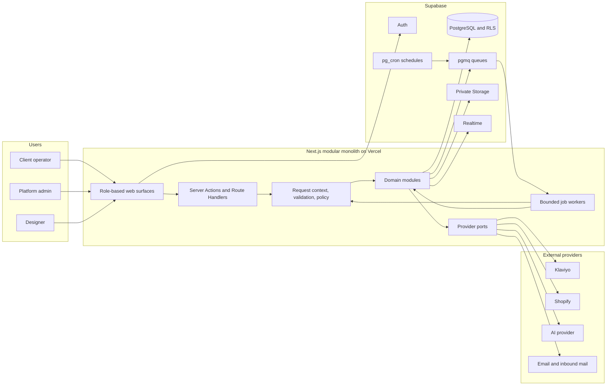
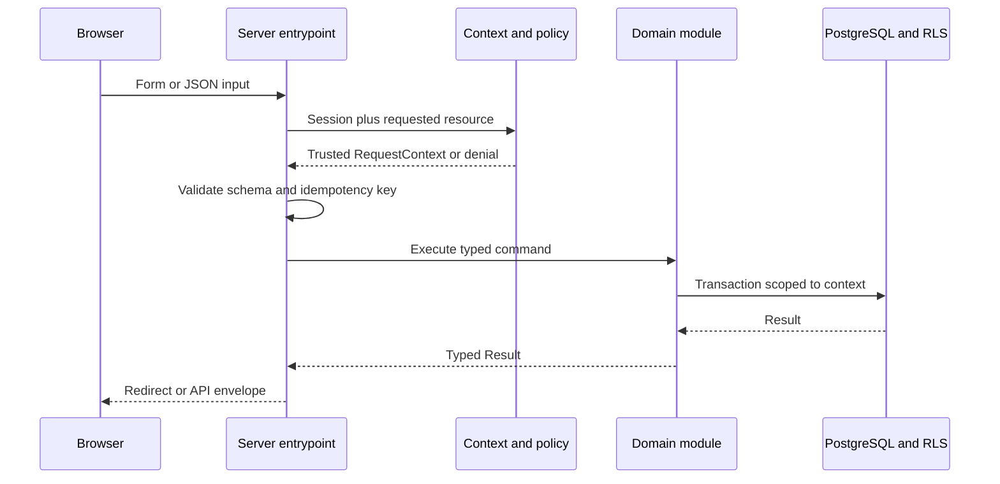
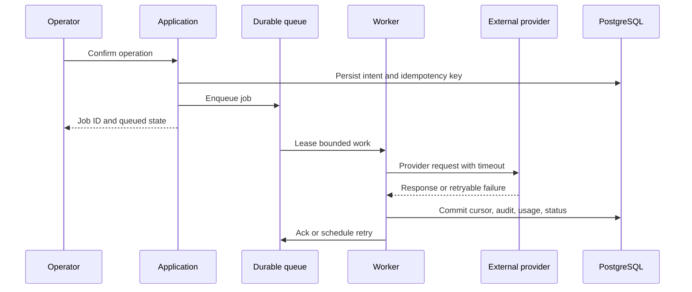
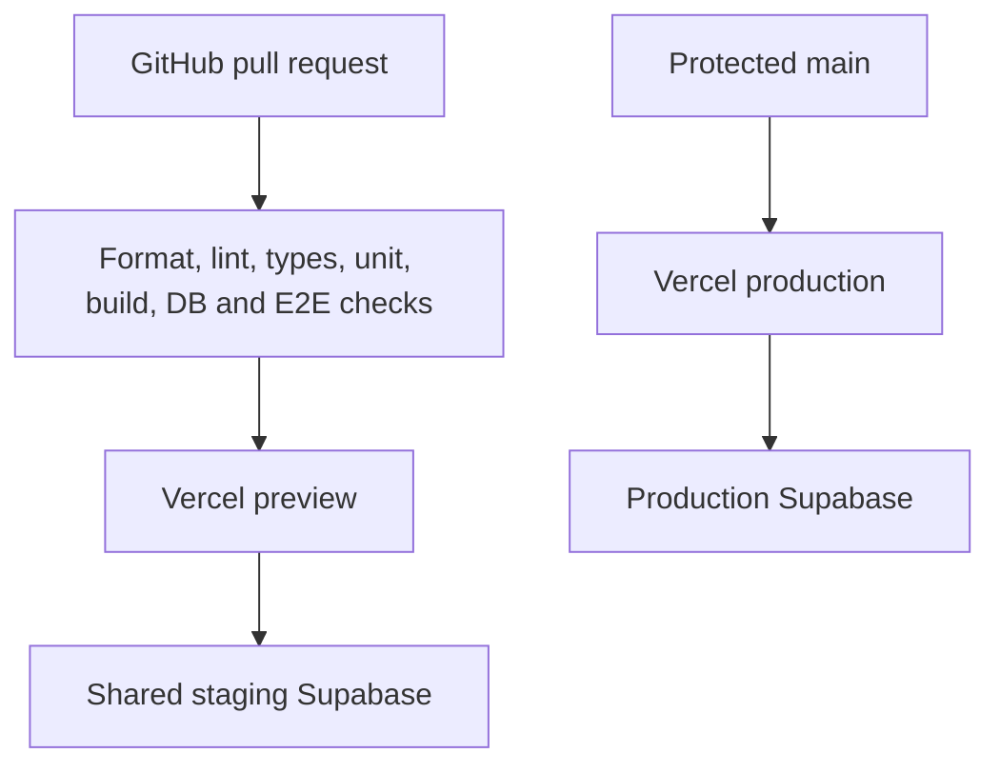

# Grey Retention — System Architecture

Status: Proposed v1 for stakeholder review

Last updated: 2026-09-14

This document explains the system shape, quality targets, component boundaries, failure handling, and growth path. `docs/ARCHITECTURE_BLUEPRINT.md` remains the implementation contract. Decisions are recorded in `docs/adr/`.

## 1. Requirements summary

### Functional requirements

The MVP must support these persisted, tenant-aware journeys:

1. A tenant member signs in, maintains brand/store context, and sees synchronized or seeded retention data.
2. An operator plans a campaign, generates AI-assisted content, selects an audience/products/references, reviews the result, and advances it through a controlled state machine.
3. A designer receives only assigned work, submits revisions, and participates in approval.
4. A platform administrator manages tenants, prompts, packages, jobs, provider health, support, and diagnostics.
5. Klaviyo data synchronizes through retryable, observable jobs. Shopify remains optional for the first vertical slice.
6. Demo mode completes the core journey without third-party secrets or billable calls.
7. White-label configuration changes identity, visual tokens, domains, email identity, copy, and feature availability without a code fork.

### Non-functional requirements

These are initial MVP targets, not promises to customers. Revisit after real usage data exists.

| Category                | MVP target                                                                                                         | Verification                                             |
| ----------------------- | ------------------------------------------------------------------------------------------------------------------ | -------------------------------------------------------- |
| Availability            | 99.9% monthly for the hosted application, excluding declared third-party outages                                   | Platform uptime and synthetic checks                     |
| Interactive performance | p95 server response under 500 ms for non-provider-backed reads; LCP under 2.5 s on representative production pages | Vercel telemetry and Playwright/Lighthouse checks        |
| Async responsiveness    | User receives a durable job ID within 1 second; long provider work does not hold a browser request open            | Integration tests and job timing metrics                 |
| Scale assumption        | First stage: 100 tenants, 25 active users per tenant, 1 million synchronized records per larger tenant             | Load fixtures and query-plan review before launch        |
| Isolation               | Zero cross-tenant data exposure; deny by default                                                                   | Two-tenant positive/negative RLS and route tests         |
| Data recovery           | Supabase-managed backups; target RPO 24 h and RTO 8 h until a paid recovery tier is approved                       | Restore runbook rehearsal before production              |
| Accessibility           | WCAG 2.2 AA for core journeys                                                                                      | Automated checks plus keyboard/screen-reader review      |
| Deployability           | Small team can deploy one application and one database without service orchestration                               | CI preview deployment and rollback rehearsal             |
| Observability           | Every request, job, AI call, and integration call has a correlation ID and sanitized structured record             | Contract/integration tests and admin diagnostics         |
| Cost control            | Free/low-cost development; production spend caps for AI and alerts for infrastructure/provider usage               | Billing alerts, tenant caps, token ledger reconciliation |

### Constraints and assumptions

- Small initial team; rapid product learning matters more than independent service deployment.
- Vercel and Supabase are the confirmed hosting baseline.
- Web is the only first-class client for the MVP.
- Product requirements will evolve; domain seams and provider ports must absorb change.
- Launch geography, regulated-data obligations, exact tenant count, and paid service budget are not yet confirmed.
- Live sends are out of scope. Preparing a provider-side draft requires explicit confirmation and remains a launch-gate decision.

## 2. Architecture style

Use a modular monolith deployed as one Next.js application, with managed Supabase capabilities and selectively asynchronous processing. Modules share a database but may not bypass each other's domain services or ownership rules.

This gives the project one build, one deployable application, one relational source of truth, and low operational load. It preserves extraction seams through feature modules, typed ports, versioned API contracts, outbox/job records, and migration ownership.

Microservices are intentionally rejected for the MVP. They would add network failure modes, duplicated authorization, distributed tracing, service deployment, and data-consistency work before the product has stable domain boundaries or traffic evidence.

## 3. High-level architecture



### Trust boundaries

1. The browser is untrusted. It receives only public configuration and short-lived user sessions.
2. Every server entrypoint authenticates, resolves a typed role/tenant context, validates input, and authorizes the use case.
3. PostgreSQL RLS is a second enforcement layer for tenant-owned data, not a substitute for server authorization.
4. Service-role credentials, provider secrets, encryption keys, webhook secrets, and cron secrets stay server-only.
5. External payloads, uploaded files, and inbound HTML are untrusted until validated and sanitized.

## 4. Component boundaries

| Component              | Owns                                                               | Must not own                                                          |
| ---------------------- | ------------------------------------------------------------------ | --------------------------------------------------------------------- |
| Route/UI composition   | Rendering, form orchestration, accessible feedback                 | Provider SDK calls, raw service-role queries, state-machine mutations |
| Request context/policy | Identity resolution, active tenant, role checks, resource policy   | Domain calculations or provider behavior                              |
| Domain modules         | Campaign, brand, AI, integration, design, support, admin use cases | Framework-specific rendering                                          |
| Repository/data access | Typed queries, transactions, scoped persistence                    | Authorization decisions without a supplied trusted context            |
| Job system             | Enqueue, lease, heartbeat, retry, dedupe, dead-letter, status      | Business rules specific to one job kind                               |
| Provider adapters      | Translate stable ports to Klaviyo, Shopify, AI, email              | Tenant policy, UI result shapes, direct cross-module writes           |
| Observability          | Correlation, structured logs, audit records, metrics               | Raw credentials, unredacted prompts, sensitive payload dumps          |

Suggested feature module structure:

```text
features/<domain>/
├─ application/     use cases and orchestration
├─ domain/          entities, policies, state machines, ports
├─ infrastructure/  Supabase repositories and provider adapters
├─ presentation/    server actions, route schemas, view models
└─ tests/
```

Modules may start smaller. Add folders only when multiple files justify them. Keep public exports explicit through each module's `index.ts`.

## 5. Critical flows

### Authenticated mutation



### Long-running provider work



Persisting intent before execution prevents a browser timeout from losing work. Provider delivery and cron invocation are treated as at-least-once; domain effects must be idempotent.

## 6. Data architecture

PostgreSQL is the system of record because the product is relational, tenant-scoped, transactional, and audit-heavy. JSONB is reserved for bounded provider snapshots, evolving structured AI output, and configuration—not as a replacement for core relational fields.

Data rules:

- UUID internal IDs; provider IDs are scoped unique keys.
- Non-null indexed `tenant_id` on tenant-owned rows.
- Money in integer minor units; AI cost in integer micro-USD.
- UTC timestamps plus tenant IANA timezone and campaign timezone snapshots.
- Immutable append-only ledgers/events for token accounting and campaign transitions.
- Soft deletion only where history or provider reconciliation needs it; otherwise explicit lifecycle state.
- RLS enabled and tested before a table becomes application-readable.
- Database migrations are the schema source of truth; generated TypeScript types are derived artifacts.

No Redis, search cluster, warehouse, or secondary operational database is added initially. Add one only after measurements show a concrete access pattern PostgreSQL cannot serve economically.

## 7. Deployment and environments



- Local: local Supabase where Docker is available; fake adapters by default.
- Preview: isolated application URL; staging data only; no production secrets.
- Production: separate Supabase project and secrets; demo-user creation disabled.
- Migrations run as an explicit release step before application traffic depends on them.
- Prefer backward-compatible expand/migrate/contract changes. Destructive contraction happens only after old application versions no longer run.

## 8. Scaling strategy

### Stage 1 — MVP

- One Next.js deployment and one Supabase project per environment.
- Server Components for read-heavy pages.
- Database indexes derived from real query paths.
- Queue workers process bounded pages/chunks within platform execution limits.
- No speculative cache layer.

### Stage 2 — measured growth

- Split worker deployment cadence/concurrency from web requests if queue latency or provider throughput requires it.
- Add read models/materialized views for expensive dashboards.
- Add a cache only for measured hot, safe-to-stale data.
- Partition the largest append-only/integration tables by time or tenant only after query plans justify it.

### Stage 3 — extraction threshold

Extract a domain service only when at least one condition is sustained:

- materially different scaling or runtime requirements;
- repeated deploy contention between independent teams;
- a fault-isolation requirement the modular monolith cannot meet;
- a regulatory boundary requiring isolated data or operations.

The first likely extraction candidate is asynchronous provider synchronization, not auth or tenancy.

## 9. Failure modes

| Failure                               | User impact                                                            | Detection                                  | Mitigation and recovery                                                            |
| ------------------------------------- | ---------------------------------------------------------------------- | ------------------------------------------ | ---------------------------------------------------------------------------------- |
| Supabase database unavailable         | Most authenticated work unavailable                                    | Readiness check, query errors              | Fail closed; preserve queued intent where possible; managed backup/restore runbook |
| Supabase Auth unavailable             | New sessions fail; existing session behavior depends on token validity | Auth error rate                            | Clear error state; no custom auth bypass; retry after provider recovery            |
| Queue/worker delayed                  | Sync/AI remains queued                                                 | Queue age and stale lease alerts           | Idempotent retry, lease recovery, admin requeue/dead-letter controls               |
| Klaviyo/Shopify rate limit            | Data stale; no data loss                                               | Provider status and `Retry-After`          | Backoff with jitter, cursor checkpoint, surface staleness timestamp                |
| Provider credentials expire           | Tenant sync stops                                                      | Permanent auth error classification        | Disable affected connection; preserve last good data; request reconnect            |
| AI provider timeout/invalid output    | Generation fails or requires retry                                     | Call status, schema validation             | One bounded repair attempt; reconcile reservation; retry only safe operations      |
| Duplicate webhook/cron delivery       | Duplicate intent                                                       | Idempotency conflicts                      | Unique event/idempotency keys and transactional dedupe                             |
| Partial deployment/schema mismatch    | A route may expect unavailable schema                                  | Preview migration test and readiness       | Expand/migrate/contract changes; rollback application; never auto-drop data        |
| Tenant-context bug                    | Potential cross-tenant exposure                                        | Negative access suite and audit anomalies  | Server policy plus RLS; deny default; incident response and key/session revocation |
| Uploaded or inbound malicious content | XSS/malware risk                                                       | Type/signature checks and security reports | Private buckets, sanitizer, sandboxed preview, scanning hook, signed URLs          |
| Vercel regional outage                | Full web outage                                                        | External synthetic monitor                 | Accept single-region MVP risk; define multi-region plan only if SLA requires it    |

## 10. Security and privacy posture

- RBAC plus tenant/resource policy checks; RLS is mandatory defense in depth.
- Sensitive credentials use server-held encryption keys or platform-managed secrets.
- Side-effecting AI/provider actions require explicit confirmation and audit.
- Webhook signatures and replay windows are verified before enqueue.
- Rate limit auth, generation, upload, invitation, connection-test, and support-write endpoints.
- Store the minimum provider payload needed; bound and redact raw snapshots.
- Define retention/deletion rules before importing production customer PII.
- Run dependency, secret, static, authorization, RLS, and E2E checks in CI.

Compliance is deliberately unclaimed. GDPR/CCPA processes, data residency, DPA terms, SOC 2 controls, and customer export/deletion requirements require stakeholder/legal confirmation before production onboarding.

## 11. Cost and operational complexity

The architecture minimizes fixed services: Vercel plus Supabase can host the MVP. Costs will grow primarily through database/storage volume, server/worker execution, provider API use, and AI tokens.

Guardrails:

- AI reservation and actual-use ledger with tenant daily/monthly caps.
- Bounded sync frequency, pagination, and retention of raw provider payloads.
- Storage type/size limits and lifecycle rules.
- Platform billing alerts before production.
- No extra infrastructure service without a measured requirement and ADR.

## 12. Architecture review gates

Confirmed and accepted:

- code-first implementation;
- original, white-label product;
- Next.js on Vercel;
- Supabase for relational data, auth, storage, realtime, and initial job primitives;
- modular monolith with typed provider adapters and fake mode.

Needs stakeholder confirmation before production architecture is considered final:

1. Expected launch tenant/user/data scale and monthly infrastructure budget.
2. Launch geography, data residency, privacy deletion/export, and compliance obligations.
3. Recovery target that justifies the required Supabase backup/PITR tier.
4. Primary AI, transactional email, and inbound-email providers.
5. Whether Shopify and provider-side Klaviyo draft creation are launch requirements.

These unknowns do not block foundation or identity work. They block production sizing, recovery commitments, and final provider selection.
