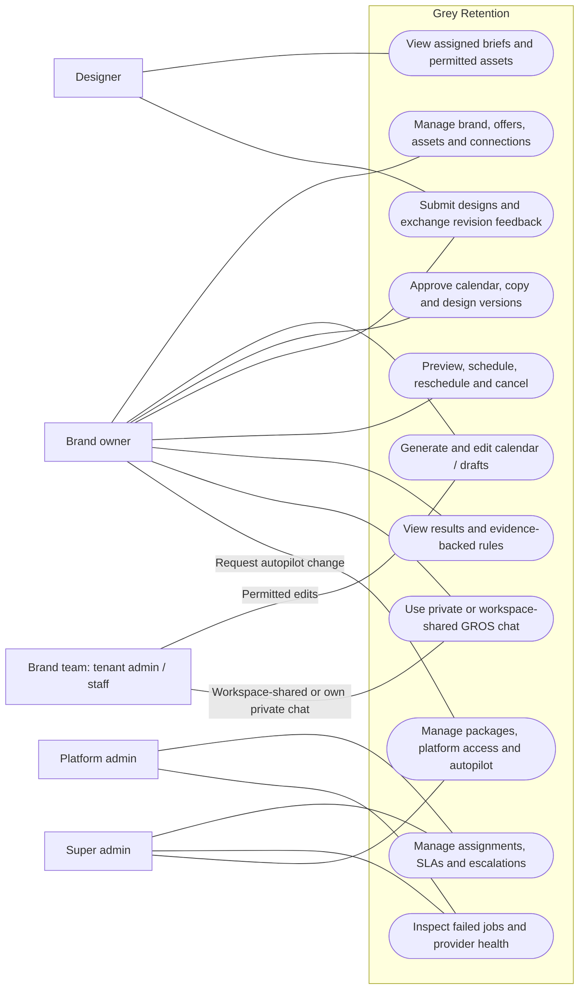
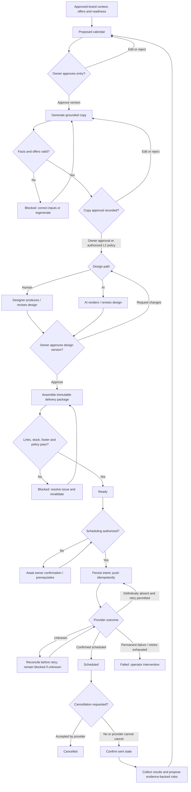

# Grey Retention v2 — UML Diagrams

Updated: October 4, 2026  
Product direction: new Next.js/Supabase implementation; brand owner leads design approval.

These diagrams describe target behavior. External actions are simulated in the unattended build. Live connections, sending, paid AI, and deployment require separate user authorization. Supporting requirements are in [USE_CASES.md](USE_CASES.md); implementation order is in [OVERNIGHT_BUILD_PLAN.md](OVERNIGHT_BUILD_PLAN.md).

## 1. Use-case diagram

Each brand has its own workspace. Lines show participation, not permission to bypass approvals. Team capabilities are scoped; private conversations are creator-only by default. Platform admin and super admin are separate existing roles; their conservative build defaults are documented in the plan.



Background workers perform generation, capture, validation, delivery, and learning within these permissions. They are system components, not additional human users. Admin assistance does not grant creative approval. Autopilot delegation is a separate explicit policy, disabled by default.

## 2. Main sequence diagram

This is the authoritative end-to-end diagram. The review loop is between the brand owner and designer, or owner and AI design worker. Admin handles assignment and escalation. Approval always refers to a particular version.

```mermaid
sequenceDiagram
    autonumber
    actor Owner as Brand Owner
    actor Team as Brand Team
    participant App as Grey Retention
    participant Jobs as AI / Jobs
    actor Designer
    actor Admin as Platform Admin
    participant K as Klaviyo Adapter

    Owner->>App: Enter domain, connect accounts, upload assets
    Owner->>App: Save allowed offers and competitor domains
    App->>Jobs: Analyze brand, classify assets, collect emails
    Jobs-->>App: Versioned brand context and capture evidence
    App-->>Owner: Present profile and readiness checklist
    Owner->>App: Correct and approve brand profile version
    Note over App,Jobs: Readiness requires sufficient assets and captured evidence

    Owner->>App: Generate 30-day calendar
    App->>Jobs: Generate from approved context and playbooks
    Jobs-->>App: Calendar entries with lineage
    App->>App: Validate offers, cadence and audience rules
    App-->>Owner: Present proposed calendar
    opt Team has permitted editing access
        Team->>App: Edit unapproved entries
    end
    Owner->>App: Approve selected calendar versions

    App->>Jobs: Generate grounded copy and sequence briefs
    Jobs-->>App: Subjects, preheaders and ordered copy strips
    App->>App: Validate facts, offers and deadlines
    App-->>Owner: Present weekly copy approval queue
    alt Owner reviews copy
        Owner->>App: Edit and approve selected copy versions
    else Eligible and explicitly enabled L2 silence policy
        App->>App: Auto-approve unchanged eligible copy after 72h
    end

    alt Human design path
        App->>App: Assign designer and establish SLA
        App-->>Designer: Approved brief, reference and scoped assets
        opt Assignment or SLA requires intervention
            App-->>Admin: Alert assignment issue
            Admin->>App: Resolve or reassign
        end
        Designer->>App: Submit design version
    else AI design path
        App->>Jobs: Render from approved copy and brand assets
        Jobs-->>App: Submit design version
    end

    App-->>Owner: Design ready for review
    loop Owner requests revisions
        Owner->>App: Feedback linked to design version and section
        alt Human design path
            App-->>Designer: Revision request and feedback history
            Designer->>App: Submit new design version
        else AI design path
            App->>Jobs: Revise requested strips
            Jobs-->>App: Submit new design version
        end
        App-->>Owner: Present revised design
    end
    Owner->>App: Approve exact final design version
    App->>App: Verify copy and design approvals are current
    App->>Jobs: Assemble strips, links, footer and UTMs
    Jobs-->>App: Versioned delivery package
    App->>App: Validate URLs, stock, exclusions and schedule

    alt L0 owner scheduling
        App-->>Owner: Final delivery preview
        Owner->>App: Confirm scheduling of package version
    else Authorized L1 or L2 background scheduling
        App->>App: Check policy and all required approvals
    end

    App->>App: Persist delivery intent and idempotency key
    App->>K: Create and schedule approved package
    alt Provider confirms outcome
        K-->>App: Campaign identity and schedule
    else Outcome unknown after timeout
        App->>K: Reconcile existing campaign and send state
        K-->>App: Confirm existing result or definitive absence
        Note over App,K: Retry creation only after definitive absence; unknown stays blocked
    end
    Note over App,K: Show scheduled status only after provider confirmation
    App-->>Owner: Confirmed status or actionable unresolved outcome

    opt Provider schedule confirmed
    alt Owner cancellation accepted before sending
        Owner->>App: Cancel scheduled campaign
        App->>K: Request cancellation
        K-->>App: Confirm cancellation
        App-->>Owner: Cancelled
    else Campaign remains scheduled
        K->>K: Send at scheduled time
        App->>K: Confirm sent state and collect 48h / 7d results
        K-->>App: Delivery state and metrics with timestamps
        App-->>Owner: Results and daily digest
        App->>Jobs: Evaluate campaign evidence
        Jobs-->>App: Eligible learned rules with sample evidence
        Note over App,Jobs: Eligible own-data rules inform future plans
    end
    end
```

The successful delivery branch requires a confirmed schedule. An unresolved push remains in reconciliation/blocked state and cannot proceed as if scheduled. Failed cancellation shows the actual provider state; it does not falsely mark the campaign cancelled. Permanent provider errors require intervention; bounded transient retries are persisted.

Owner-led design approval is the default at every level. This permits L1/L2 automatic scheduling after approval, but fully unattended L2 additionally needs explicit owner delegation of design review. That delegation is not approved merely by selecting an autopilot level and stays disabled until its policy is settled.

## 3. Campaign workflow diagram

The product lifecycle below is the planning view. Implement approval, design, delivery, and job states as separate typed records where appropriate; do not make queue failures overwrite creative approval state.



Changing approved content, products, or offers invalidates dependent copy/design/package approvals. A materially changed design requires a new owner approval. Audience, sender, link, footer, or schedule changes invalidate the delivery package and applicable delivery confirmation. A reschedule uses provider reconciliation and the same policy checks.

## 4. Additional schema-informed requirements

The incomplete previous-project SQL paste supplied October 4 shows structural support for owner feedback/tenant rejection, revision history, private/shared conversations, approval-aware retried actions, and prepared delivery artifacts. These are workflow evidence only. Missing table definitions, constraints, and closing statements prevent a complete database reconstruction.

No old channel enum or table field automatically adds scope. SMS is deferred during the unattended email-first build; WhatsApp is not a new-product requirement. Tenant staff rights and non-super platform-admin rights use conservative defaults pending final capability decisions.
