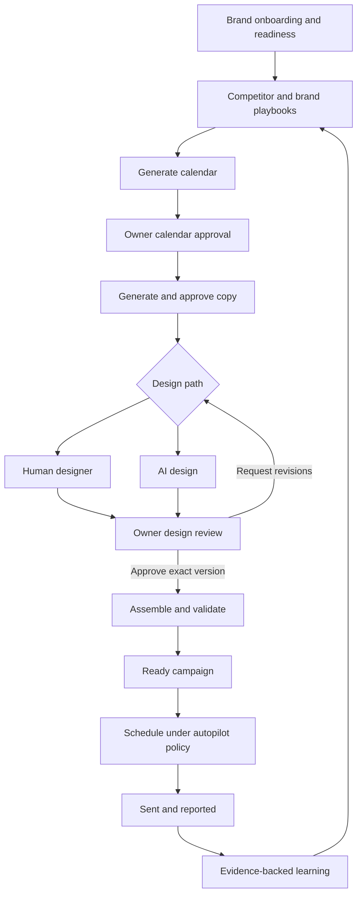

# Grey Retention — New Product Use Cases

Date: October 3, 2026  
Updated: October 4, 2026  
Status: proposed product requirements for planning  
Task: DOC-001

## 1. Purpose and source boundaries

Build a new retention-marketing product in the existing Next.js/Supabase repository. A brand owner supplies brand context and approvals; the product coordinates strategy, copy, design, delivery, and learning.

These use cases are derived from the user-supplied **Full Product PRD v2, October 3, 2026**, the repository's discovery and architecture documents, a structural inventory of the previous PHP codebase, and schema-only findings from the incomplete October 4 SQL paste. The archive establishes the presence of workflow-related components; it does not establish that those components work correctly. No previous source, private prompts, credentials, customer content, or runtime data is included here.

The current repository has foundation and identity completed, with shared UI in progress. The use cases below describe target behavior, not completed functionality. They do not authorize live provider actions. The October 4 blueprint amendment makes owner-led design approval the target contract and permits simulated delivery implementation. Live sending remains separately authorization-gated. Updated diagrams are in [UML_DIAGRAMS.md](UML_DIAGRAMS.md); implementation order and the agent prompt are in [OVERNIGHT_BUILD_PLAN.md](OVERNIGHT_BUILD_PLAN.md).

## 2. Actors

| Actor                    | Responsibility and access                                                                                                                                                                      |
| ------------------------ | ---------------------------------------------------------------------------------------------------------------------------------------------------------------------------------------------- |
| Brand owner              | Onboards their brand, sets permitted offers, reviews strategy/copy, approves exact design versions, sees reports, and cancels their sends. Requests autopilot changes.                         |
| Super admin              | Operates brands, manages assignments and escalations, diagnoses failures, manages packages, and sets autopilot levels under the agreed policy. Acts on behalf of a brand with an audit record. |
| Designer                 | Receives assigned approved briefs and relevant assets; uploads and revises designs. Cannot access revenue, integration secrets, unrelated drafts, or unrelated brand assets.                   |
| GROS / automated workers | Generate and propose actions, process background work, and execute only within actor permissions and the brand's approved automation policy.                                                   |
| External systems         | Klaviyo, Shopify, Drive, inbound email, AI, and notification providers accessed through application-owned adapters.                                                                            |
| Public visitor           | Searches the optional public archive; cannot access tenant-private content or performance.                                                                                                     |

Tenant admin/staff permissions use conservative development defaults in the build plan pending final capability decisions. Membership alone does not grant owner approval rights. Non-super platform admins handle permitted assignments/escalations and sanitized diagnostics; super admins additionally handle platform settings/packages/autopilot. Neither silently inherits owner creative approval.

## 3. Primary end-to-end scenario

**Illustrative scenario:** the fictional brand Cedar Lane wants to run a month of email campaigns without producing each campaign manually.

1. The owner creates a workspace, enters their domain, and connects Klaviyo and Shopify.
2. The system drafts brand facts and voice. The owner corrects and approves them, saves allowed offers, uploads assets, and selects three competitors.
3. Background jobs classify assets and collect competitor emails. The workspace shows exactly which readiness requirements remain unmet.
4. Once readiness is satisfied, the system produces a market playbook with links to the supporting emails.
5. The owner generates a 30-day calendar, adjusts the mix, and approves selected entries.
6. The system writes grounded copy. The owner reviews a week's drafts together, edits two drafts, and approves the resulting versions.
7. A designer or the AI design path produces designs from approved copy and classified brand assets. The owner reviews the design, requests section-specific revisions, and approves the exact final version. Admin handles assignment and SLA escalation.
8. The system assembles the email, maps links, attaches the footer, and checks product availability and scheduling rules.
9. At L0, the owner reviews the final package and schedules it. At L1, the approved policy schedules Ready campaigns automatically, subject to the unresolved authority decision in section 8.
10. The owner can cancel before sending. After sending, they receive a digest and can inspect campaign results.
11. Results collected at 48 hours and seven days contribute to evidence-backed rules once minimum samples are met.

The owner does not need to open Klaviyo during this journey. Readiness is based on evidence, not a guaranteed day-eight deadline.

The diagram is a proposed journey, not a replacement for the existing campaign-state enum. Calendar behavior at L2 remains open.

## 4. Core use cases

### UC-01 — Create a workspace and approve brand context

**Actor:** brand owner. **Trigger:** the owner starts onboarding. **Precondition:** an authenticated account, or successful signup as part of the journey. **Source:** PRD §4; identity baseline.

1. Create/select a workspace and enter its domain and timezone.
2. Run a bounded website analysis asynchronously to draft brand facts, voice, winning angles, objections, and proof; collect the brand kit without a full-site imagery crawl.
3. Let the owner correct individual facts and approve the resulting version. Preserve corrections over future AI guesses.
4. Verify Klaviyo credentials; optionally connect Shopify. Save structured allowed offers, limits, prohibited offers, and evergreen offers.
5. Resume onboarding after leaving and show a readiness checklist.

**Exceptions:** failed crawl permits manual context; failed connection explains the reconnect action; missing required inputs keep readiness incomplete. No invalid or unapproved context unlocks calendar generation.

**Success/acceptance:** the owner can complete active setup in under 20 minutes, excluding asynchronous learning. The PRD readiness gate requires Klaviyo connected, owner-approved profile, offer whitelist saved, at least 20 classified assets, and at least three LIVE competitors with ten captured emails each. That gate is provisional pending the learning-window decision.

### UC-02 — Ingest, classify, and correct brand assets

**Actor:** brand owner; background workers. **Trigger:** upload or Drive sync. **Precondition:** authorized workspace access. **Source:** PRD §4 steps 4–4b.

1. Upload individual images or a ZIP, supporting batches of approximately 500 images, or connect authorized read-only Drive folders.
2. Validate files, ingest in recoverable batches, detect duplicates, and show processing status.
3. Classify product, lifestyle, UGC/proof, logo/graphic, and unusable assets. Match products/variants where reliable catalog data exists.
4. Let the owner correct tags and matches. Make usable assets available to assigned designers and design generation.

**Exceptions:** corrupt files fail individually; ambiguous matches remain unresolved; expired Drive access prompts reconnect; repeated syncs do not duplicate assets. Unusable assets cannot silently enter a design.

**Success/acceptance:** at least 90% of product shots match the correct catalog product on a defined 100-image evaluation sample. Variant accuracy and the no-Shopify fallback need separate definitions.

### UC-03 — Track competitors and capture emails

**Actor:** brand owner; capture workers. **Trigger:** the owner adds three to ten competitor domains. **Precondition:** workspace access and configured capture transport. **Source:** PRD §§4–5, 11.

1. Validate domains and establish or reuse a shared capture subscription.
2. Handle subscription confirmation through the capture workflow and show PENDING/LIVE/first-capture progress.
3. Ingest emails once, deduplicate them, sanitize previews, and extract timestamp, subject/preheader, campaign type, offers, products, strips, CTAs, and design characteristics.
4. Expose captured emails and capture health to brands authorized to track that competitor.

**Exceptions:** failed opt-in remains pending; uncertain extraction is marked for correction; a previously active competitor silent for 14 days receives a warning. Competitor silence alone is not proof of an ingestion failure.

**Success/acceptance:** two brands tracking one competitor share capture records while their subscriptions, private rules, and brand-specific playbooks remain isolated. Every successful extraction links back to its source email.

### UC-04 — Generate and inspect the market playbook

**Actor:** brand owner; intelligence workers. **Trigger:** request or weekly refresh. **Precondition:** sufficient validated competitor evidence. **Source:** PRD §5.

1. Aggregate competitor classification, cadence, offers, and event behavior.
2. Detect sequence candidates using shared offer code, shared featured product, or greater than 70% thematic similarity within five days.
3. Synthesize patterns relevant to this brand, distinguishing adjacent-category style references from direct-market strategy.
4. Show sequence objects, evidence counts, source dates, and links to individual emails.

**Exceptions:** insufficient evidence produces an explicit incomplete view; unverified patterns cannot be presented as proven performance. The similarity score and sequence tie-breaking need an evaluation contract.

**Success/acceptance:** the owner can inspect the source of a proposed cadence, offer pattern, or sequence. Generated client copy uses original language; competitor patterns do not establish competitor revenue or conversion results.

### UC-05 — Generate, edit, and approve a 30-day calendar

**Actor:** brand owner; planning agent. **Trigger:** Generate Calendar. **Precondition:** readiness satisfied and approved input versions available. **Source:** PRD §6.

1. Combine brand context, permitted offers, playbook, holidays/custom events, past performance, and owner rules.
2. Propose dated entries with time, channel, objective, audience, angle, products, offer, reference, lineage, and sequence membership.
3. Validate cadence, discount frequency, offer spacing/conflicts, audience exclusions, and traceability on the server.
4. Let the owner approve, edit, or reject entries. Save feedback as explicit rules with their scope visible.
5. Regenerate only unapproved entries and account for approved/existing sends in guardrail calculations.

**Exceptions:** contradictory rules or insufficient offers produce an explanation rather than fabricated campaigns. Copy generation waits for the relevant entry's approval. SMS entries wait for SMS policy/support if included.

**Success/acceptance:** seeded plans satisfy all guardrails, every entry has input lineage, approved entries survive regeneration, and a representative owner can approve a month in under 30 minutes. Default caps are five campaign emails/week per engaged audience, discounts on no more than 40% of sends, and no two distinct sitewide offers within seven days; sequence handling needs clarification.

### UC-06 — Generate grounded copy and approve it in bulk

**Actor:** brand owner; copy agent. **Trigger:** an approved calendar entry becomes eligible for copy. **Precondition:** approved brand/product/offer context. **Source:** PRD §7.

1. Generate three subject choices, preview text, and an ordered strip brief with product content and CTAs. Generate sequence copy together.
2. Validate offers, verified claims, product facts, and expiry/deadline consistency before presenting the draft.
3. Notify the owner in-app and by email; show a weekly approval queue.
4. Allow inline/GROS edits, rejection with reasons, and explicit selection of versions for bulk approval.
5. Record the approval actor and content version. Release approved copy to design.

**Exceptions:** invented claims or unauthorized offers block the draft. After 72 hours, hold/re-notify by default; auto-approval applies only under an authorized L2 silence policy. A stale bulk action cannot approve a newer unseen revision.

**Success/acceptance:** no unapproved copy reaches design; every approved campaign identifies its exact approved version. A material later change invalidates affected downstream approvals; the precise invalidation matrix is proposed in section 7.

### UC-07 — Produce a design through a human designer

**Actor:** assigned designer; brand owner; admin for assignment/escalation. **Trigger:** approved copy selects the human path. **Precondition:** approved copy and authorized assignment. **Source:** PRD §8 Path A.

1. Assign a designer and establish the 24-hour SLA.
2. Assemble the approved strip brief, reference, relevant classified assets, and brand kit into an inspiration pack.
3. Let the designer submit a revision and notes.
4. Let the owner review the submitted version and request changes with section-specific feedback. Deliver the feedback to the assigned designer, persist resubmissions/history, and obtain owner approval of the exact final version. Admin handles assignment and SLA escalation.

**Exceptions:** no available designer alerts admin; unauthorized access is denied; a changed brief makes a submission stale rather than silently approved.

**Success/acceptance:** the designer can complete assigned work without browsing unrelated tenants, revenue, credentials, or unapproved drafts. Revisions retain their review history.

### UC-08 — Produce and review an AI design

**Actor:** design worker; brand owner. **Trigger:** approved copy selects the AI path. **Precondition:** suitable classified assets and budget. **Source:** PRD §8 Path B.

1. Build a design from approved copy, reference structure, brand assets, fonts, and colors.
2. Present it for the same owner review as a human design. Bind feedback and approval to the design version.
3. Allow per-strip regeneration, image replacement, and transfer to a human designer.
4. Record which asset and copy version each strip uses.

**Exceptions:** missing assets require correction or human handoff; exhausted budget blocks new generation; reviewers cannot introduce unapproved claims or offers through design edits.

**Success/acceptance:** product imagery comes from approved brand assets, never generated product shots or stock. Both design paths must meet a shared review rubric before assembly.

### UC-09 — Assemble and validate the final email

**Actor:** assembly workers; reviewer. **Trigger:** design approval. **Precondition:** approved design/copy, configured footer and links. **Source:** PRD §8 and §9 push contents.

1. Slice the design and map product strips to catalog URLs and hero/CTA strips to the approved primary link.
2. Attach the designated universal footer and apply the brand's UTM convention.
3. Validate links, featured-product stock, required fields, and policy checks.
4. Create a versioned delivery package and display its preview. Mark the campaign Ready only when every required check passes.

**Exceptions:** broken links, missing footer, stale catalog data, and unavailable products block readiness. Footer interaction must preserve multiple destinations where required; a whole footer cannot assume one URL.

**Success/acceptance:** the package captures content, assets, links, audience, sender, timezone, and schedule. The PRD specifies HTTP 200 link checks; redirect handling, freshness, transient failures, and image-only/text-channel differences need definition.

### UC-10 — Schedule, send, reschedule, or cancel a campaign

**Actor:** owner at L0; authorized automation at L1/L2; super admin. **Trigger:** schedule request or Ready event. **Precondition:** approved current package, healthy connection, and applicable authorization. **Source:** PRD §9.

1. Provision/reconcile canonical G | segments after their definitions are finalized; resolve names to this account's provider IDs.
2. Recheck package version, schedule, cadence, stock, exclusions, footer, and authorization immediately before push.
3. Create the provider campaign from the approved package and schedule it; record external identity and reconciliation state.
4. Report scheduling/sending status. Support reschedule/cancel with confirmation of the provider outcome.

**Exceptions:** a provider timeout after creation triggers reconciliation before retry. Failed pushes follow the specified three-retry policy and then alert admin; permanent validation/auth errors require intervention. Cancellation races show the confirmed result and never claim success without provider evidence.

**Success/acceptance:** 100 consecutive test pushes preserve audience, links, footer, content, and schedule from preview. Replayed jobs cannot create duplicate campaigns or sends. Cancellation is available until the provider can no longer prevent delivery; the exact cutoff must be established.

### UC-11 — Ask GROS to explain or propose a change

**Actor:** brand owner; authorized admin. **Trigger:** a question or edit request in workspace/draft chat. **Precondition:** scoped access to referenced resources. **Source:** PRD §§2, 10–11, 13.

Resolve private/shared conversation visibility before every read or action. Private conversations are creator-only by default; shared conversations are scoped to active permitted workspace members. Sharing a conversation does not transfer proposal execution authority. Admin diagnostics do not expose private content by default.

1. Answer from authorized brand facts, campaign state, playbook lineage, and available performance evidence.
2. Present a concrete proposed change and its consequences when an action is requested.
3. Obtain required confirmation and revalidate the target/version before execution.
4. Execute through domain policies and durable jobs; record actor, action, reason, and outcome.

**Exceptions:** ambiguous dates/audiences need clarification; stale proposals require review; requests outside the whitelist or permissions are rejected. L2 never grants unrestricted agent authority.

**Success/acceptance:** the owner can ask why a campaign exists and see its sources. At L0/L1, new side-effecting chat requests remain confirm-gated; L1 background scheduling authority is an open decision.

### UC-12 — Read campaign results and learn from them

**Actor:** brand owner; reporting/learning workers. **Trigger:** a send, daily digest, or dashboard visit. **Precondition:** delivery identity and structured campaign metadata recorded. **Source:** PRD §§9, 13.

1. Collect results at 48 hours and seven days; retain collection window, metric source, and freshness.
2. Show recipients, engagement, revenue, unsubscribes, spam, and relevant attribution definitions.
3. Compare results by angle, offer, audience, timing, design, and sequence position.
4. Propose evidence-backed rules only after minimum samples; allow owner pin/dismiss controls.
5. Use eligible own-data rules ahead of competitor patterns and cite them in future calendar lineage.

**Exceptions:** missing/delayed data remains visibly incomplete; insufficient samples do not generate influential rules; correlations are not presented as causal proof.

**Success/acceptance:** the default comparison requires five campaigns per side, with evidence visible. Rules cannot override an explicit owner prohibition or hard offer/safety constraint. A daily digest distinguishes what was sent from revenue measured so far.

### UC-13 — Request and operate an autopilot level

**Actor:** owner requests; super admin sets; workers enforce. **Trigger:** a level-change request or eligibility event. **Precondition:** policy prerequisites satisfied. **Source:** PRD §§9–10.

| Level | Copy                                                       | Final design                                 | Scheduling                                                         |
| ----- | ---------------------------------------------------------- | -------------------------------------------- | ------------------------------------------------------------------ |
| L0    | Owner approves                                             | Owner approves exact design version          | Owner explicitly schedules                                         |
| L1    | Owner approves                                             | Owner approves exact design version          | Automatically schedules on Ready under a persisted standing policy |
| L2    | May auto-approve after 72h under configured silence policy | Owner review; delegation disabled by default | Automatically schedules/sends under policy                         |

**Main flow:** show eligibility and consequences, accept the owner's request, let authorized admin set the level, audit the policy version, and enforce it on every affected operation.

The unattended build implements L2 simulation and eligibility, with production L2 enablement disabled pending final policy. L1 standing scheduling authorization never confirms unrelated GROS proposals.

**Exceptions:** unmet eligibility blocks L2. The PRD requires ten sent campaigns with no owner rejections; streak definition and reset/downgrade conditions remain open. Level changes must define the treatment of already queued actions.

**Success/acceptance:** the current level and its permissions are visible and enforced server-side. Calendar approval at L2 is not assumed to disappear. The owner's cancellation capability remains available. Fully unattended L2 requires separately confirmed owner delegation of design approval; selecting L2 alone does not grant it.

## 5. Supporting and expansion use cases

### UC-14 — Control AI usage and recover failed operations

**Actor:** owner views usage; super admin operates; workers meter. **Source:** PRD §11; existing queue/AI contracts.

Before paid work, reserve budget against tenant/package limits; attribute actual use to feature, provider/model, and operation; reconcile reservations on completion/failure. Show soft alerts at 80% and block new spend at 100%. Check connection health daily and expose queued/retrying/failed work to authorized operators.

**Acceptance:** concurrent jobs cannot spend the same remaining allowance; retries do not duplicate effects; reconnect/requeue does not lose approval history. Existing approved delivery is not automatically cancelled merely because new AI generation is blocked. Exact per-feature package pricing and in-flight spend policy remain open.

### UC-15 — Run a bill optimization sweep

**Actor:** owner; super admin; optimization workers. **Source:** PRD §14. **Scope:** separate extension after audience/suppression contracts.

Identify candidates, exclude protected recent purchasers, present the first sweep for owner approval, run an approved two-email winback over ten days where justified, suppress eligible nonresponders, and report the outcome and estimated plan savings. Preserve history and provide an audited reversal workflow.

**Acceptance:** anyone ordering within the last 12 months is excluded under the PRD guardrail, even if they match the default 120-day engagement/180-day order candidate rule. Reversal respects suppression reasons and consent. Pricing snapshots have dates and savings are estimates until provider billing confirms them. Handling hard bounces/spam before winback and later-sweep authority need decisions.

### UC-16 — Reuse a template or build a campaign from a reference

**Actor:** owner; super admin curates. **Source:** PRD §§15.2–15.3.

Save a brand's own sent design with its structured skeleton and performance. From an authorized template/reference, start a draft that inherits structure while using the client's facts, products, assets, voice, colors, and fonts. Route it through the same calendar/offer/copy/design checks.

**Acceptance:** reference selection does not bypass approval or copy another brand's executed creative. A brand can reuse its own authorized designs. Cross-client curation requires a defined permission policy; private performance is not exposed by library membership.

### UC-17 — Search the public email archive

**Actor:** public visitor. **Source:** PRD §15.1. **Scope:** separate product track and infrastructure budget.

Search public captured emails by brand, niche, offer, type, time, structure, and sequence; inspect brand cadence/offer history; sign in to create a client-specific draft from an allowed reference.

**Acceptance:** public views contain only approved public archive data, never tenant assets, internal notes, credentials, or client performance. Archive publication, retention, attribution, and takedown rules must be set before launch.

### UC-18 — Manage access, settings, support, and platform configuration

**Actor:** authorized tenant member; super admin. **Source:** PRD §§2, 10; baseline MVP/discovery requirements.

Owners manage team access and brand defaults; authorized users open support tickets; admins operate assignments, packages, prompt versions, provider settings, and job diagnostics. Changes preserve history and show their tenant scope.

**Acceptance:** inactive membership cannot authorize work; invitation/access changes are audited; administrative changes cannot silently rewrite used prompt versions or active package snapshots. Exact tenant staff/admin capabilities and owner-versus-admin copy overrides remain to be specified.

## 6. Build order and traceability

| Delivery slice             | Use cases                            | Existing workstream touchpoints | Exit result                                                                             |
| -------------------------- | ------------------------------------ | ------------------------------- | --------------------------------------------------------------------------------------- |
| Baseline workflow          | UC-01, 06–07, 11, 14, 18 foundations | UI, CAM, AI, INT, OPS, DSG, SUP | Persisted campaign journey works with fake providers and authorized roles.              |
| Onboarding and assets      | UC-01–03                             | AI/Brand, INT, REF, IAM         | Owner context, offers, assets, and capture readiness are visible and durable.           |
| Competitor intelligence    | UC-03–04                             | REF, AI, INT                    | Evidence-linked competitor sequences and a brand-specific playbook.                     |
| Calendar and copy approval | UC-05–06, 11                         | CAM, AI, SUP                    | Valid month plan and weekly copy review queue.                                          |
| Design and assembly        | UC-07–09, 16 foundations             | DSG, CAM, REF, AI               | Both paths produce reviewed, verified packages. Human path can ship first.              |
| Controlled delivery        | UC-10, 12 foundations, 13 L0/L1, 14  | INT, CAM, OPS, SUP              | Preview fidelity, scheduling, cancellation, results collection, and diagnostics proven. |
| Autopilot and learning     | UC-12–13 L2                          | AI, CAM, INT, OPS               | Eligible automation and evidence-backed rules with clear authority.                     |
| Extensions                 | UC-15–17                             | Dedicated tasks to be defined   | Optimizer, richer templates, and separately budgeted public archive.                    |

Collect learning metadata from the first delivered campaign. Competitor capture foundations can start before asset onboarding is complete. Templates do not need the entire public archive to exist.

## 7. Proposed cross-cutting acceptance rules

These extend the product requirements for planning; record approved changes in the architecture blueprint before implementing shared contracts.

1. **Approval binds to a version.** A material copy/offer/product change invalidates dependent design and delivery approval. An audience/schedule change revalidates delivery permissions and cadence. A cosmetic change's review requirements need a defined matrix.
2. **Hard rules win.** Explicit prohibited offers, permissions, exclusions, and budget limits cannot be weakened by prompts, learned rules, GROS, or an autopilot level.
3. **Evidence is retained.** Generation records input versions and lineage; learning retains samples, metric windows, and limitations.
4. **Background work is durable.** Jobs expose state, attempt, progress, error, and recovery. Provider side effects reconcile after unknown outcomes before retrying.
5. **Access is scoped.** Two-tenant and assigned-designer negative tests cover data, files, actions, proposals, and diagnostics.
6. **Preview is the delivery contract.** Approval and provider creation use the same immutable package. Readiness checks run again against current external conditions before execution.
7. **Time is explicit.** Store UTC, retain tenant/campaign timezone context, and show the actual scheduled local time. Quiet hours and daylight-saving boundaries require tests if SMS is included.
8. **No hidden bypass.** Bulk approval, reference-based creation, admin overrides, and retry/requeue use the same policy services as ordinary actions.

## 8. Decisions required before the affected slice

| ID   | Decision                                                                                                                                                                                                                               | Required before              |
| ---- | -------------------------------------------------------------------------------------------------------------------------------------------------------------------------------------------------------------------------------------- | ---------------------------- |
| D-01 | Ten emails per competitor versus a 7–8-day window: lower initial threshold, historical backfill, or longer readiness? Are safe evergreen sends allowed before full readiness?                                                          | Onboarding/calendar          |
| D-02 | Final G \| segment names, definitions, reconciliation, account scopes, and recipient-overlap handling for cadence caps.                                                                                                                | Audience generation/delivery |
| D-03 | Confirm final L1 standing scheduling policy and delegated team capabilities. Development default: L0 owner confirms, L1 auto-schedules after owner approvals, new GROS mutations confirm, admin cannot bypass owner creative approval. | Approval/delivery            |
| D-04 | L2 eligibility streak/reset rules, calendar approval, explicit owner delegation of design approval, queued-action behavior on level changes, and pause/downgrade triggers.                                                             | Autopilot                    |
| D-05 | Shopify requirement or alternate catalog for product matching, stock, URLs, and claims.                                                                                                                                                | Assets/assembly              |
| D-06 | Email-first or SMS launch scope; distinct text-email assembly; SMS consent and recipient-timezone policy.                                                                                                                              | Calendar/channel design      |
| D-07 | Design renderer, review rubric, supported fonts, strip boundaries, accessible content, and per-strip revision behavior.                                                                                                                | Design                       |
| D-08 | Capture provider, opt-in mechanics, source timestamps, retained history, and evaluated sequence similarity.                                                                                                                            | Competitor intelligence      |
| D-09 | What counts as a discount/sitewide offer, campaign versus sequence spacing, cap windows, audience overlap, and new-brand ramp policy.                                                                                                  | Calendar guardrails          |
| D-10 | Validation freshness, HTTP redirects/transient failures, cancellation cutoff, missed-send deadlines, and exact push retry semantics.                                                                                                   | Assembly/delivery            |
| D-11 | AI/provider pricing, budget reservation rules, primary providers, Drive sync limits, and production infrastructure budget.                                                                                                             | Paid processing              |
| D-12 | Learning comparisons, attribution windows, sample sufficiency, confidence, standing-rule precedence, and conflicting owner feedback.                                                                                                   | Learning                     |
| D-13 | Suppression reasons/consent, hard-bounce/spam treatment, reversal rules, purchaser protection, later-sweep authority, and billing estimates.                                                                                           | Optimizer                    |
| D-14 | Cross-client template permissions and public archive publication/retention/takedown policy.                                                                                                                                            | Shared templates/archive     |

## 9. Planning handoff

Use each UC identifier as a traceable requirement in the implementation task and its acceptance tests. Split large use cases into bounded tasks with explicit owned paths. Follow the updated blueprint and build plan. Update campaign-state contracts, provider ports, and ledger under V2-000 before dependent implementation; do not silently introduce competing states. The original PRD admin-review gate is superseded by the user-confirmed owner review flow. Private/shared GROS conversations, submission history, approval-aware actions, and prepared artifacts are supported by structural evidence from the prior SQL schema; do not import its records or treat the incomplete paste as a complete data model.

No application code, migrations, dependencies, provider connections, deployments, or sends are part of DOC-001.
